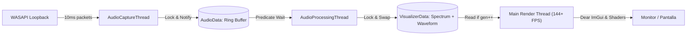

# Audio Visualizer 3.0

Visualizador de audio en tiempo real para Windows: captura el sonido del sistema por loopback WASAPI, lo analiza con FFTW y lo dibuja con OpenGL 3.3 Core y shaders GLSL, con un panel de control en Dear ImGui.


## Estado del proyecto

**Mantenimiento.** La versión 3.0 está completa (fases A a D del documento 11 y diseño Fluent del documento 12). Cuatro pruebas numéricas se ejecutan con `ctest`. No se publican binarios: se compila desde el código.

Importante: un clon limpio necesita los binarios **x64 de GLEW 2.1.0**, que nunca llegaron a versionarse (ver [Obtener GLEW x64](#obtener-glew-x64)).

## Características

- Captura loopback WASAPI de la salida activa o elegida, con cambio de dispositivo en caliente y detección de formato con mezcla a mono.
- Análisis FFTW en precisión simple: ventana de Hann, 2048 muestras con salto de 256, dB normalizados; resolución variable opcional (FFT larga en graves, corta en agudos).
- Bandas configurables con métricas (energía, RMS, pico), dinámica de ataque y caída por banda y reconstrucción de la onda de cada banda por IFFT enmascarada (la suma de las bandas reproduce la señal).
- **Seis modos visuales** (enum `VisualizerMode` en `src/core/types.h`, un módulo por modo en `src/render/modes/`):

| Tecla | Modo | Descripción |
|---|---|---|
| `1` | Barras con peak-hold | Una barra por banda; el marcador de pico se mantiene `peak_hold_time_ms` y cae con `peak_decay_speed`. |
| `2` | Radial | Espectro en coordenadas polares; los graves pulsan el núcleo. |
| `3` | Osciloscopio | Forma de onda con haz antialiasing tipo CRT. |
| `4` | Cascada (waterfall) | Historial del espectro en una textura 2D con paleta térmica. |
| `5` | Osciloscopio apilado | Una traza por banda reconstruida y la mezcla debajo. |
| `6` | Medidores por banda | Nombre, rango, nivel en dB, pico y color por banda. |

- Panel Dear ImGui (`Tab` o `H`) para ajustar ganancia, ataque, caída, colores, escalas, bandas y material, y guardar en `config.json`.
- Diseño Fluent: material acrílico propio detrás del panel; Mica y Acrílico del sistema en Windows 11; transiciones que respetan las preferencias de accesibilidad.
- Render sincronizado con el refresco del monitor (vsync), con limitador adaptativo si el controlador lo ignora.

## Stack y versiones

| Pieza | Versión |
|---|---|
| Lenguaje | C++17 (MSVC `/W4 /utf-8 /permissive-`) |
| Build | CMake 3.20+ y solución de Visual Studio (`.sln`, toolset v145) |
| Gráficos | OpenGL 3.3 Core, GLSL, GLFW 3.4, GLEW 2.1.0 |
| Interfaz | Dear ImGui 1.91.5 |
| FFT | FFTW 3.3.5 (`libfftw3f-3`, float) |
| JSON | nlohmann/json 3.12.0 |
| Audio | WASAPI (COM), avrt, winmm |

## Requisitos

- Windows 10 u 11, x64. GPU con OpenGL 3.3.
- Visual Studio con la carga de trabajo «Desarrollo para el escritorio con C++». El `.sln` usa el toolset **v145** (Visual Studio 2026); con Visual Studio 2022 use la ruta de CMake (o cambie el toolset del proyecto a v143).
- CMake 3.20 o superior (3.21 para usar los presets).
- Los binarios x64 de GLEW 2.1.0 (siguiente apartado).

## Obtener GLEW x64

El repositorio solo contiene GLEW **Win32** (`glew-2.1.0/lib/Release/Win32`, `glew-2.1.0/bin/Release/Win32`). Hasta la versión 3.0.0 el `.gitignore` tenía la regla `x64/`, que excluía también las carpetas x64 de GLEW; nunca se versionaron, tampoco en el historial. CMake y el `.vcxproj` esperan:

```
glew-2.1.0/lib/Release/x64/glew32.lib
glew-2.1.0/bin/Release/x64/glew32.dll
```

Opción A (recomendada, sin tocar el proyecto): descargar `glew-2.1.0-win32.zip` de la página oficial de versiones de GLEW (<https://github.com/nigels-com/glew/releases/tag/glew-2.1.0>; pese al nombre incluye x64) y copiar `lib/Release/x64/glew32.lib` y `bin/Release/x64/glew32.dll` a las rutas anteriores. La regla del `.gitignore` ya está corregida, de modo que pueden versionarse si se desea.

Opción B (vcpkg): `vcpkg install glew:x64-windows` y copiar `glew32.lib` (de `installed/x64-windows/lib`) y `glew32.dll` (de `installed/x64-windows/bin`) a las mismas rutas. vcpkg instala una versión de GLEW más reciente que 2.1.0, compatible en la API que se usa (carga de OpenGL 3.3).

La migración completa a vcpkg en modo manifiesto está pendiente (ver [Pendientes](#limitaciones-y-pendientes)).

## Compilar y ejecutar

### Con CMake

```powershell
cmake -B build -S . -A x64
cmake --build build --config Release
ctest --test-dir build -C Release
.\build\Release\audio-visualizer.exe
```

Con los presets incluidos (`CMakePresets.json`, generador por defecto de CMake = Visual Studio más reciente instalado):

```powershell
cmake --preset vs-x64
cmake --build --preset release
ctest --preset release
```

El post-build copia `libfftw3f-3.dll`, `glew32.dll`, `glfw3.dll`, `shaders/` y `config.json` junto al ejecutable.

### Con Visual Studio (.sln)

Abrir `audio-visualizer.sln`, elegir `Release|x64` y pulsar F5. Las listas de fuentes del `.vcxproj`, del `.filters` y del `CMakeLists.txt` se regeneran a partir de `src/` con `python tools/update_build_lists.py`.

## Uso

Al arrancar captura la salida de audio por defecto. `Tab` o `H` muestra u oculta el panel; las teclas `1` a `6` cambian de modo (tabla de características). La configuración se edita en el panel y se guarda con «Guardar en config.json». Detalles en el [manual de usuario](docs/07_user_manual_and_config.md).

### config.json

Tres secciones: `estilos` (aspecto, dinámica, modo, vsync, material), `bandas` (modo, cortes en Hz, nombres, ataque y caída, ganancia y color por banda) y `analisis` (resolución variable: tamaños de FFT y frecuencias de corte). El archivo de ejemplo es [`config.json`](config.json).

## Documentación

| Documento | Descripción |
|---|---|
| [01. PRD Lean](docs/01_prd_lean.md) | Visión, objetivos, matriz In/Out Scope y requerimientos funcionales/no funcionales. |
| [02. Especificación Técnica](docs/02_tech_spec.md) | Arquitectura de hilos, shaders GLSL, Dear ImGui, WASAPI y CMake. |
| [03. UX Flows y 7 Estados](docs/03_ux_flows.md) | Ciclo de vida del sistema, ergonomía y mapa de estados visuales. |
| [04. Kanban y Criterios BDD](docs/04_kanban_bdd.md) | Épicas, DoD, DoR y escenarios de prueba formales *Given-When-Then*. |
| [05. Arquitectura y Pipeline Matemático](docs/05_architecture_and_pipeline.md) | Fórmulas de Hann, FFTW r2c, mapeo de octavas, dBFS, filtros IIR independientes de FPS y shaders. |
| [06. Guía de Compilación y Toolchain](docs/06_build_and_toolchain.md) | Instrucciones para CMake, Ninja, Visual Studio, VS Code y resolución de errores. |
| [07. Manual de Usuario y Configuración](docs/07_user_manual_and_config.md) | Guía del panel interactivo, atajos, telemetría y referencia de `config.json`. |
| [08. Guía de Contribución y Estándares](docs/08_contributing_and_standards.md) | Estándares C++17, concurrencia, RAII y tutorial para añadir nuevos modos visuales. |
| [09. Recomendaciones y Mejoras](docs/09_recommendations_and_future_improvements.md) | Cola SPSC Lock-Free, Bloom/Glow, Compute Shaders, iconografía y CI/CD con GitHub Actions. |
| [10. Teoría de Descomposición en Bandas](docs/10_signal_decomposition_theory.md) | Demostraciones: inversión de la DFT, Parseval, reconstrucción perfecta por solapamiento, teorema de la suma de bandas, incertidumbre de Gabor, conservación de la información, volúmenes de datos, CQT. Con confirmación empírica de las pruebas. |
| [11. Arquitectura de la Trama de Análisis](docs/11_analysis_frame_architecture.md) | `AnalysisFrame`, bandas configurables, triple búfer, texturas, dinámica por banda, osciloscopio apilado, resolución variable, configuración, presupuesto y fases con resultados. Implementado. |
| [12. Diseño Fluent y Post-procesado](docs/12_fluent_design_ui.md) | Mica y Acrílico del sistema, material acrílico propio, desenfoque separable demostrado, ruido, integración con ImGui, movimiento, DPI, contraste WCAG. Implementado. |
| [13. Bitácora de Desarrollo](docs/13_development_log.md) | Cronología por commit, errores clasificados por origen, mediciones antes y después, estado verificado y no verificado, deuda técnica y reproducción de las verificaciones. |
| [Índice Maestro de Docs](docs/README.md) | Mapa de navegación completo de la documentación técnica. |

## Estructura del proyecto

```
audio-visualizer/
|-- CMakeLists.txt                  Configuración de construcción CMake moderna
|-- CMakePresets.json              Presets de CMake (vs-x64, release, debug)
|-- LICENSE                         GNU GPL v3.0
|-- CHANGELOG.md                    Historial de versiones
|-- audio-visualizer.sln            Solución de Visual Studio
|-- config.json                     Configuración inicial en tiempo de ejecución
|-- docs/                           Documentación formal (PRD, Tech Spec, UX Flows, Kanban)
|-- tests/band_metrics_test.cpp     Prueba numerica de bandas y Parseval (objetivo CMake)
|-- tests/band_synthesis_test.cpp   Prueba numerica de la reconstruccion y la suma de bandas
|-- tests/motion_test.cpp           Prueba de las curvas y duraciones de las transiciones
|-- tests/resolution_test.cpp       Prueba de la resolucion variable frente a la latencia
|-- tools/                          Scripts: regenerar listas de fuentes, prueba de humo, CPU por hilo
|-- shaders/                        Shaders GLSL (Modern OpenGL 3.3 Core)
|   |-- bars.vert / bars.frag       Shader para barras y marcadores de pico
|   |-- quad.vert                   Vertex shader común para modos de pantalla completa
|   |-- radial.frag                 Fragment shader para espectro circular
|   |-- waveform.frag               Fragment shader para osciloscopio analógico CRT
|   `-- waterfall.frag              Fragment shader para espectrograma térmico cascada
|
|-- src/                            Codigo fuente, una carpeta por capa
|   |-- main.cpp                    Punto de entrada: app::Run()
|   |-- app/application.*           Ciclo de vida: configuracion, hilos y cierre ordenado
|   |-- core/                       Sin dependencias de Windows ni OpenGL
|   |   |-- constants.h             FFT_SIZE, HOP_SIZE, RING_SIZE
|   |   |-- types.*                 VisualizerMode, AudioDeviceInfo
|   |   |-- shared_state.h          AudioData, VisualizerData (puntos de intercambio)
|   |   |-- analysis_frame.h        AnalysisFrame: todo lo que el analisis extrae de una ventana
|   |   |-- triple_buffer.h         Intercambio productor-consumidor sin bloqueos
|   |   |-- band_layout.*           BandConfig, validacion y particion del espectro en bandas
|   |   `-- config.*                VisualizerConfig, LoadConfig, SaveConfig
|   |-- audio/                      Captura WASAPI
|   |   |-- sample_format.*         Deteccion de formato y mezcla a mono
|   |   |-- device_enumerator.*     Endpoints y nombres amigables
|   |   |-- capture_session.*       Una sesion de loopback sobre un endpoint
|   |   `-- capture_thread.*        COM, MMCSS, reintentos y cambio de dispositivo
|   |-- analysis/                   Procesado de senal
|   |   |-- window_function.*       Hann periodica y normalizacion
|   |   |-- band_metrics.*          Energia, RMS y pico por banda
|   |   |-- band_synthesizer.*      Ondas por banda: IFFT enmascarada, solapamiento y suma
|   |   |-- multi_resolution.*      FFT larga en graves y corta en agudos (resolucion variable)
|   |   `-- analysis_thread.*       Ventana deslizante, FFT, dB, publicacion
|   |-- render/                     OpenGL 3.3 Core
|   |   |-- gl_window.*             Ventana GLFW, GLEW, refresco del monitor
|   |   |-- shader_program.*        Carga y compilacion GLSL
|   |   |-- embedded_shaders.h      Copias de shaders/ para arrancar sin la carpeta
|   |   |-- fullscreen_quad.*       Quad compartido por los modos procedurales
|   |   |-- data_textures.*         Texturas de espectro, onda y cascada
|   |   |-- band_waveform_texture.*  Historial circular en GPU de las ondas por banda
|   |   |-- bar_spectrum.*          Bins a barras, lineal o logaritmico, dB a [0, 1]
|   |   |-- spectrum_dynamics.*     Ataque, caida y peak-hold por tiempo real
|   |   |-- frame_limiter.*         Limitador adaptativo cuando el driver ignora vsync
|   |   |-- post_process.*          Escena a textura, desenfoque separable, presentacion
|   |   |-- panel_material.*        Material acrilico propio detras del panel (callback de ImGui)
|   |   |-- renderer.*              Bucle principal de render
|   |   `-- modes/                  Un modulo por modo visual (IVisualMode)
|   |       |-- visual_mode.h       Interfaz y RenderContext
|   |       |-- bars_mode.*         1. Barras con peak-hold
|   |       |-- radial_mode.*       2. Radial
|   |       |-- waveform_mode.*     3. Osciloscopio
|   |       |-- waterfall_mode.*    4. Cascada
|   |       |-- band_meters_mode.*  5. Medidores por banda (tecla 6)
|   |       `-- stacked_oscilloscope_mode.*  6. Osciloscopio apilado (tecla 5)
|   |-- platform/                   Windows: efectos DWM (Mica, Acrilico, marco oscuro) y preferencias
|   |   `-- window_effects.*
|   `-- ui/                         Dear ImGui
|       |-- theme.*                 Estilo y HelpMarker
|       |-- telemetry.*             Metricas y titulo de la ventana
|       |-- motion.h                Curvas de deceleracion y transiciones por tiempo real
|       |-- panel_material.h        Interfaz del material que usa el HUD
|       `-- hud.*                   Panel de control por pestanas
|
|-- fftw-3.3.5-dll64/               FFTW 3.3.5 (DLL, headers y .lib x64)
|-- glew-2.1.0/                     GLEW 2.1.0 (Extension loader para OpenGL 3.3+)
|-- glfw-3.4.bin.WIN64/             GLFW 3.4 (Ventana y contexto)
|-- imgui-1.91.5/                   Dear ImGui 1.91.5 (núcleo y backends GLFW + OpenGL3)
`-- json-develop/                   nlohmann/json 3.12.0 (Serialización JSON)
```

## Arquitectura

Tres hilos concurrentes desacoplados sin contención de bloqueo en el hilo de render:



- **Captura (WASAPI)**: Extrae paquetes de audio de la salida activa o seleccionada, convierte a flotante mono y escribe en el anillo circular de 8192 muestras.
- **Procesado (FFT)**: Toma las 2048 muestras más recientes cada 256 muestras nuevas, aplica ventana de Hann periódica, ejecuta FFTW r2c (1025 bins), interpola bandas en escala lineal/logarítmica y normaliza en dB.
- **Renderizado (OpenGL 3.3 + ImGui)**: Dibuja las barras o texturas procedurales con shaders GLSL a la frecuencia de actualización del monitor y procesa la interfaz interactiva.

## Dependencias de terceros y licencias

Todas están versionadas en el repositorio (no se descarga nada al configurar), salvo GLEW x64 (ver arriba).

| Biblioteca | Versión | Forma | Licencia |
|---|---|---|---|
| FFTW | 3.3.5 | DLL x64 (`fftw-3.3.5-dll64/`) | GPL-2.0 o posterior (`COPYING`) |
| GLFW | 3.4 | Binarios WIN64 (`glfw-3.4.bin.WIN64/`) | zlib/libpng (`LICENSE.md`) |
| GLEW | 2.1.0 | Binarios y cabeceras (`glew-2.1.0/`) | BSD modificada + MIT (Mesa) + Khronos (`LICENSE.txt`) |
| Dear ImGui | 1.91.5 | Fuentes (`imgui-1.91.5/`) | MIT (`LICENSE.txt`) |
| nlohmann/json | 3.12.0 | Cabeceras (`json-develop/`) | MIT (`LICENSE.MIT`) |

FFTW es GPL; por eso el proyecto se distribuye bajo GPL-3.0 (compatible con la cláusula «o posterior» de FFTW).

## Limitaciones y pendientes

- **Modernización del build pendiente**: dependencias por **vcpkg** en modo manifiesto (`vcpkg.json` + `find_package`), sustituir GLEW por **glad** (sin DLL) y **CI en GitHub Actions** (`windows-latest`: configurar, compilar y `ctest`). Hasta entonces, GLEW x64 se obtiene a mano.
- Dependencias antiguas: GLEW 2.1.0 (2017) y FFTW 3.3.5 (2016; la vigente es 3.3.10).
- Los binarios vendorizados incluyen variantes que no se usan (GLFW para otros compiladores, FFTW double y long double, GLEW Win32, utilidades); el `.vcxproj` enlaza además `libfftw3-3.lib` sin necesitarlo.
- Dos sistemas de build en paralelo (CMake y `.sln`), sincronizados por `tools/update_build_lists.py`.
- Solo Windows x64. Pendientes funcionales (DPI por monitor, otros desenfoques, etc.) en el [documento 13](docs/13_development_log.md), §6.

## Autor y licencia

Marlon Torres Espinoza. Distribuido bajo la licencia **GNU GPL v3.0**; ver [LICENSE](LICENSE). Las bibliotecas de terceros conservan sus licencias (tabla anterior).
